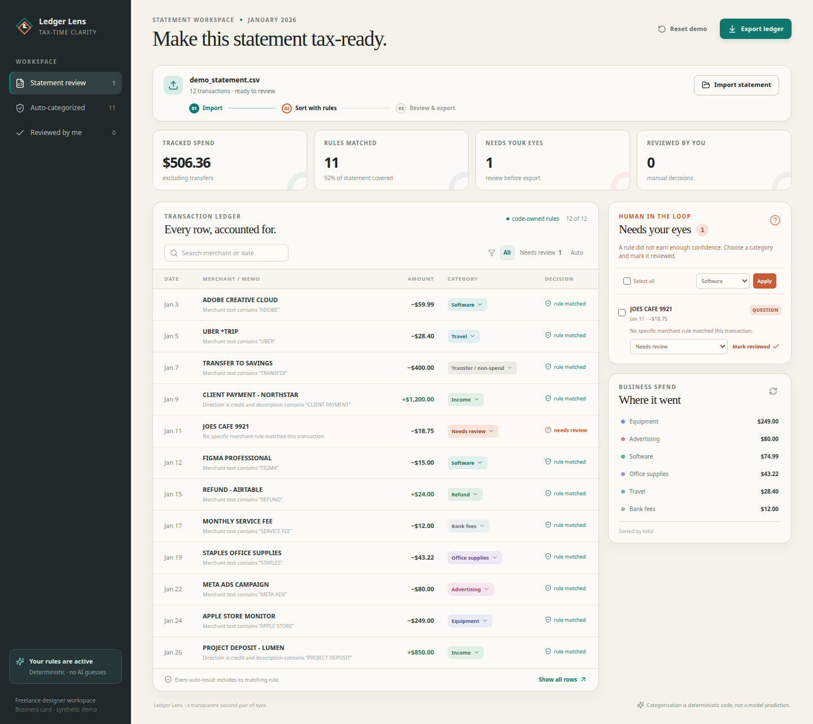

# AI usage

## Tools used

- **Manus agent coding tools:** used to inspect the starter repo, read the managed web guidance, write the React interface, Python backend, tests, fixtures, and documentation, and run local checks.
- **No decision model:** no GPT, Claude, Gemini, embeddings, external classifier, or hosted AI API is used by Ledger Lens to assign a transaction category. The categorization brain is the ordered rule table written in code.

## How AI helped

The coding agent helped translate the brief into a usable workflow, choose a freelance-designer statement use case, design the review-first interaction, and produce implementation and test code. It also helped catch edge cases to cover: refunds must not become income, transfers are not spend, malformed rows need a reason, exact duplicates need review, and generic positive inflows need review.

## Where AI got things wrong or needed correction

The initial starter page was only an example screen and did not satisfy the product requirements. It was replaced. The first implementation plan also considered a managed database even though the approved blueprint left that power-up unselected; the final product uses local browser state for the demo and includes a standalone Python API without requiring a database. These were corrected before delivery. The agent was also explicitly constrained not to use a large model for categorization; all category outcomes are produced by `backend/categorizer.py` or its browser mirror.

## Token / usage log

This project was created in one Manus coding session. The tool interface did not expose a per-call token counter, so the exact input/output token total is recorded as **unavailable**, not estimated or fabricated. A screenshot captured with the webdev Preview tool is included as repository evidence:

The verifiable usage record is the repository change history and the commands listed below:

- `pnpm check`
- `pnpm test`
- `pnpm build:static`
- `python3 -m unittest discover -s backend -p 'test_*.py'`

If a future run exposes provider usage data, append the exact input/output token counts here rather than estimating them.
